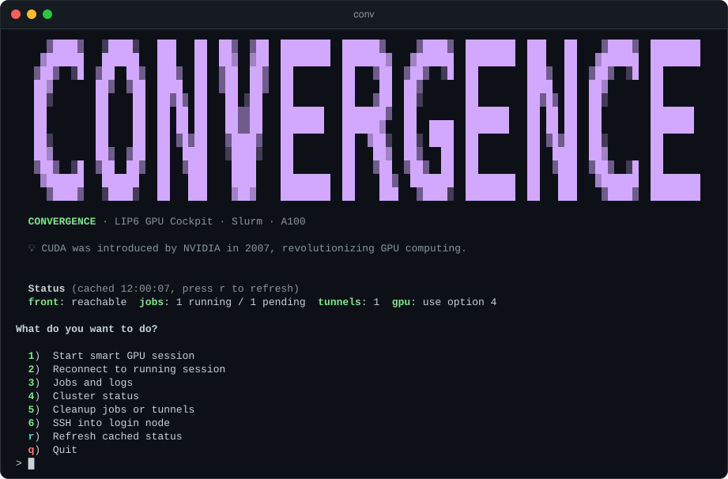
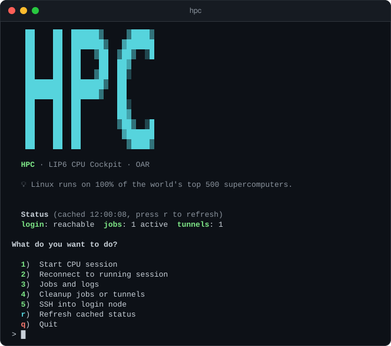

<p align="center">
  
</p>

<p align="center">
  <b>Jupyter Lab on a LIP6 GPU or CPU node, in your browser, from a simple menu.</b><br>
  One installer sets up passwordless SSH. Then <code>conv</code> or <code>hpc</code> does the rest: no Slurm or OAR commands to learn.
</p>

<p align="center">
  <a href="https://github.com/Allaa-boutaleb/lip6-cluster-setup/actions/workflows/tests.yml"></a>
  
  
  <a href="LICENSE"></a>
</p>

<p align="center">
  <a href="#-getting-started">Getting started</a> ·
  <a href="#%EF%B8%8F-what-you-get">What you get</a> ·
  <a href="#-everyday-recipes">Recipes</a> ·
  <a href="#-troubleshooting">Troubleshooting</a> ·
  <a href="#-reference">Reference</a>
</p>

An unofficial, community-made tool for the two LIP6 clusters (Sorbonne University):

| Command | Cluster | Hardware | Scheduler |
|---|---|---|---|
| `conv` | **Convergence** | NVIDIA A100: full 80GB GPUs or 40GB MIG slices | Slurm |
| `hpc` | **HPC** | CPU nodes, up to 48 cores per job | OAR |

## 🚀 Getting started

You need a LIP6 account with access to at least one of the clusters, and a terminal: the **Terminal** app on macOS, any terminal on Linux, **Git Bash** or **WSL** on Windows. There is nothing else to install: bash and `ssh` are enough.

### 1. Get the code and run the installer

```bash
git clone https://github.com/Allaa-boutaleb/lip6-cluster-setup.git
cd lip6-cluster-setup
./lip6-cluster-setup
```

<details>
<summary><b>No git?</b> Download the release instead</summary>
<br>

Download `lip6-cluster-setup.zip` from the [latest release](https://github.com/Allaa-boutaleb/lip6-cluster-setup/releases/latest) and unzip it. Open a terminal in the unzipped folder (the one that contains `lip6-cluster-setup`) and run `./lip6-cluster-setup`.

Or do it all from the terminal:

```bash
curl -L https://github.com/Allaa-boutaleb/lip6-cluster-setup/releases/latest/download/lip6-cluster-setup.tar.gz | tar xz
cd lip6-cluster-setup
./lip6-cluster-setup
```

</details>

<details>
<summary><b>On Windows?</b> Use Git Bash or WSL</summary>
<br>

- **Git Bash:** install [Git for Windows](https://git-scm.com/download/win), open **Git Bash** and run the three commands above. The browser opens with `start`. Windows' `ssh` cannot share connections, so each menu action logs in again, which is a little slower.
- **WSL:** install [WSL](https://learn.microsoft.com/en-us/windows/wsl/install) (Ubuntu recommended), open its terminal and run the commands there. The browser opens with `wslview` or `explorer.exe`.

Pick one and stick to it: Git Bash and WSL each have their own home folder, SSH key and aliases.

</details>

### 2. Answer a few questions

| It asks for | What to answer |
|---|---|
| LIP6 username | The one you use on lab machines, e.g. `jdupont` |
| Email | Where Slurm and OAR send your job notifications, e.g. `firstname.lastname@lip6.fr` |
| Your team | This picks your SSH gateway: `ssh.lip6.fr`, `barder.lip6.fr` or `ducas.lip6.fr` |
| Your storage group | Your team storage path on HPC, shown by `hpc-help`. *Not sure / other* is fine |
| Which clusters | HPC, Convergence, or both (the default) |

Pressing Enter takes the default shown in `[brackets]`. You then get a summary to confirm, and the installer copies your SSH key to the servers.

> [!IMPORTANT]
> When `ssh` asks for a password, type your **LIP6 secure password** (the Wi-Fi / workstation one), **not** your email password. Nothing shows while you type; that is normal.
> You may be asked a few times, about once per server. After that you never type it again.

When everything worked, the installer ends like this:

```text
================================================================
  Setup complete!
================================================================

Open a new terminal, then:

  hpc   — CPU cluster manager (OAR, up to 48 cores)
  conv  — GPU cluster manager (SLURM, A100 GPUs)

Quick SSH:

  ssh hpc    — login to HPC cluster
  ssh conv   — login to Convergence

On the cluster, type:

  hpc-help   — HPC commands reference
  conv-help  — Convergence commands reference

Happy computing!
```

> [!NOTE]
> If a step fails, it ends with **Setup finished with problems:** and one line per problem instead. Fix what it says and run `./lip6-cluster-setup` again: re-running is safe.

### 3. Open a new terminal and type `conv` or `hpc`

A menu opens: type a number and press Enter. To get Jupyter on a GPU, type `conv`, then `1`, then just **press Enter at every question**. When the job starts (right away if a GPU is free, longer when the cluster is busy), your browser opens Jupyter Lab, running on one full A100 for 8 hours:

```text
================================================
  GPU Session ready!
================================================

  Job:    123456
  Node:   node03
  Port:   41827
  URL:    http://127.0.0.1:20047/lab?token=…

Tunnel running in background; it stays up after you quit or close this window.
Use option 5 (Cleanup) to disconnect.
Opening Jupyter in browser...
```

> [!TIP]
> The very first GPU launch also installs Jupyter Lab on the cluster (in `~/.venvs/conv_jupyter`), which takes a few minutes. Later launches skip it.

## 🖥️ What you get

Two small terminal menus ("cockpits"). Each opens with a status line (press `r` to refresh it), a fun fact and the menu. Your jobs keep running when you quit the menu or close the laptop, and the Jupyter tunnel runs in the background.

### `conv`: Convergence, the GPU cluster

<p align="center">
  
</p>

| Key | What it does |
|---|---|
| `1` | **Start a GPU session:** Jupyter Lab, a terminal on a compute node, both, or your own batch script. Every question has a default |
| `2` | **Reconnect** to a job you started earlier (picked for you if it is your only one) |
| `3` | **Your jobs:** running and pending, with time left; type a job ID for its details |
| `4` | **Cluster status:** each node's GPUs, how many are in use, its CPUs, memory and state |
| `5` | **Cleanup:** cancel one job or all of them (their log files go too), then close tunnels |
| `6` | **SSH** into the login node |

<details>
<summary><b>The questions behind option 1</b></summary>
<br>

| Question | Press Enter for | Other answers |
|---|---|---|
| GPU type | `1` A100 80GB full (node01-06) | `2` A100 40GB MIG (node07-10), for smaller jobs |
| How many GPUs | 1 | Up to 4 (full) or 8 (MIG) |
| How long | 8 hours | `30m`, `2d`, `1d 6h`, `08:00:00`… up to 14 days |
| Job name | `gpu-session` | Letters, digits, `-`, `_` |
| CPU vendor | `1` Intel | `2` AMD (full A100 only; that is node01) |
| RAM size | Slurm's default | `128G`, `512G`, `2048000M`, or `0` for the node's full memory |
| Exact node | Slurm chooses | `node01` to `node10`; it must match the GPU type and the CPU vendor |
| How to work | `1` Jupyter Lab | `2` terminal on the node, `3` both, `4` submit your own script |

- The Slurm QoS follows from the duration: `short` up to 1 day, `normal` up to 7 days, `long` up to 14 days.
- **Jupyter Lab** submits a batch job, waits for it to start, then opens Jupyter in your browser through an SSH tunnel.
- **Terminal only** is an interactive `salloc` session: it ends when you disconnect. Use `1` or `3` for sessions that last.
- **Both** gives you Jupyter and prints the `ssh -t -J conv nodeXX.convergence.lip6.fr` command for a terminal on the node.
- **Custom script** submits a script that is already on the cluster (e.g. `~/train.sh`) with the GPUs you asked for. Its output goes to `~/<job name>-<job id>.out` there.

Option `3` groups your jobs by state:

```text
RUNNING
  JobID    Name                 Elapsed      TimeLimit    TimeLeft     Node
  ──────────────────────────────────────────────────────────────────────────────
  12345    gpu-session          2:15:00      8:00:00      5:45:00      node03

PENDING
  JobID    Name                 TimeLimit    Reason
  ──────────────────────────────────────────────────────────────
  12346    training             1-00:00:00   (Resources)
```

</details>

### `hpc`: HPC, the CPU cluster

<p align="center">
  
</p>

| Key | What it does |
|---|---|
| `1` | **Start a CPU session** on one of the `big*` nodes: Jupyter Lab, a terminal, or both |
| `2` | **Reconnect** to a job you started earlier |
| `3` | **Your jobs** (`oarstat`) |
| `4` | **Cleanup:** cancel one job or all of them (their log files go too), then close tunnels |
| `5` | **SSH** into the login node |

<details>
<summary><b>The questions behind option 1</b></summary>
<br>

| Question | Press Enter for | Other answers |
|---|---|---|
| How many cores | 24 | 1 to 48 |
| How long | 24 hours | `8h`, `1d 6h`, `24:0:0`… up to 1000 hours for Jupyter, 24 hours for a terminal |
| How to work | `1` Jupyter Lab | `2` terminal, `3` both |

- **Jupyter Lab** submits an OAR batch job and tunnels Jupyter to your browser.
- **Terminal only** opens a shell on the HPC login node and shows the `oarsub ... -I` command to start your interactive session there.
- **Both** gives you Jupyter and prints `ssh -t hpc "OAR_JOB_ID=<id> oarsh <node>"` for a terminal on the node.

</details>

## 🧭 Everyday recipes

**Jupyter on a GPU.** `conv` → `1` → press Enter at every question. One full A100 80GB for 8 hours. Want two GPUs for two days? Answer `2` at *How many GPUs?* and `2d` at *How long?*.

**Jupyter on CPUs.** `hpc` → `1` → Enter, Enter, Enter. 24 cores for 24 hours.

**Back to Jupyter after closing the laptop.** `conv` → `2` → `1` (or `hpc` → `2` → `1`). If you have one job it is picked for you; otherwise type its ID. The tunnel is restarted if needed and the browser opens again.

**See your jobs.** `conv` → `3` or `hpc` → `3`.

**Cancel jobs and close tunnels.** `conv` → `5` or `hpc` → `4`. Type a job ID, or `all` and then `yes`. Then it lists your open tunnels: type a job ID or `all` to close them, or just press Enter to keep them.

**Check for free GPUs.** `conv` → `4`. On the cluster itself, `conv-status` shows GPU usage too.

**Run your own training script on GPUs.** `conv` → `1`, answer the questions, then choose `4` at *How do you want to work?* and give the script's path on the cluster, e.g. `~/train.sh`.

**SSH straight in.** `ssh conv` or `ssh hpc` from any terminal (or `6` in `conv`, `5` in `hpc`). For a shell on the node running your job: `2`, then `2` (*Terminal only*).

> [!TIP]
> Durations accept `30m`, `8h`, `3d`, `1d 6h 30m`, `08:00:00`, or a plain number of hours. Press **Ctrl+C** while waiting for a job: only the waiting stops, the job keeps running. Reconnect later with option `2`; the scheduler also emails you about the job.

## 🩺 Troubleshooting

<details>
<summary><b><code>conv: command not found</code></b></summary>
<br>

Open a **new** terminal: the `conv` and `hpc` aliases are read when a terminal starts. You can also run `~/conv-manager` or `~/hpc-notebook` directly. `./lip6-cluster-setup doctor` checks that the cockpits and the SSH config are installed.

</details>

<details>
<summary><b>It asks for my password every time</b></summary>
<br>

Your key did not reach that server. Run `./lip6-cluster-setup doctor --remote`: it tries a passwordless login to `hpc` and `conv` and says `ok` or `unavailable` for each. Then run the installer again: it only asks for a password where the key is not installed yet. Make sure you type the **secure** password (not the email one) and pick the right team, since the team decides your gateway. `ssh -v hpc` or `ssh -v conv` shows what goes wrong.

If a terminal on a Convergence *compute node* asks for a password, run the installer again: its "node-to-node SSH" step may not have completed (the final summary lists it when it fails).

</details>

<details>
<summary><b>The status line says <code>unreachable</code> (off campus, VPN, gateway)</b></summary>
<br>

The cockpit could not log in within a few seconds. Test the link with `ssh conv true` or `ssh hpc true`, and add `-v` to see why it fails.

- `hpc` goes through your team's gateway (`ssh.lip6.fr`, `barder.lip6.fr` or `ducas.lip6.fr`, chosen from your team in step 2). If `barder.lip6.fr` does not work for you, run the installer again and pick team option `3` (`ducas.lip6.fr`).
- `conv` connects straight to `front.convergence.lip6.fr`.
- Outside the LIP6 network? Check your network and VPN.

Press `r` in the menu to refresh the status once it works.

</details>

<details>
<summary><b>My job was rejected</b></summary>
<br>

You see **Job was NOT submitted.** followed by the scheduler's own message. Often you are at a job or time limit: cancel a job (`5` in `conv`, `4` in `hpc`), or ask for less time, fewer GPUs or fewer cores. The limits are 14 days on Convergence, and 1000 hours (Jupyter) or 24 hours (terminal) on HPC. If you are not sure whether a job went through, check your jobs (`3`) before trying again.

</details>

<details>
<summary><b>"Still queued", or it waits forever</b></summary>
<br>

The cluster is busy. The cockpit waits 10 minutes on Convergence (5 on HPC), then stops waiting; your job stays in the queue. Come back later with option `2`, or cancel it from Cleanup. You can also press Ctrl+C at any time while waiting.

</details>

<details>
<summary><b>"Jupyter didn't start" or "Job ended"</b></summary>
<br>

Read the job's error log on the cluster:

```bash
ssh conv 'cat ~/*-<jobid>.err'     # Convergence
ssh hpc 'cat ~/OAR.<jobid>.stderr' # HPC
```

On Convergence, if installing Jupyter failed, the cockpit shows the end of `~/.conv_jupyter_install.log` (on the cluster).

</details>

<details>
<summary><b>The browser did not open</b></summary>
<br>

Copy the `URL:` line (`http://127.0.0.1:<port>/…`) into your browser. This happens when no browser can be opened from where the cockpit runs, e.g. on Linux without a desktop. If you see **Tunnel failed to start.**, the lines under it are `ssh`'s reason.

</details>

<details>
<summary><b>Logging in to a cluster hangs or behaves oddly</b></summary>
<br>

```bash
./lip6-cluster-setup doctor --remote
./lip6-cluster-setup repair-login        # Convergence
./lip6-cluster-setup repair-login hpc    # HPC
```

`repair-login` moves a `~/.ssh/rc` login hook on that cluster to `~/login-rescue/`, and removes the LIP6 alias blocks from its `~/.bashrc` (the previous file is kept as `~/.bashrc.lip6-bak`). Run the installer again to get the aliases back. The setup itself never installs automatic SSH hooks in `.bashrc`.

</details>

## 📚 Reference

<details>
<summary><b>Durations</b></summary>
<br>

| Input | Meaning |
|---|---|
| `30m` | 30 minutes |
| `8h` | 8 hours |
| `3d` | 3 days |
| `3d 12h` | 3 days 12 hours |
| `1d 6h 30m` | 1 day 6 hours 30 minutes |
| `8:0:0`, `08:00:00` | 8 hours (H:M:S) |
| `24` | 24 hours (plain number) |

Limits: 14 days on Convergence; on HPC, 1000 hours for Jupyter and 24 hours for a terminal session.

</details>

<details>
<summary><b>What the installer changes</b></summary>
<br>

| Step | What happens |
|---|---|
| SSH key | Creates `~/.ssh/id_ed25519` if you have no key yet (no passphrase; it prints how to add one) |
| SSH config | Writes `~/.ssh/config.d/lip6` (hosts `lip6`, `hpc`, `conv` and the Convergence compute nodes) with `IdentitiesOnly yes`, and adds `Include config.d/*` at the top of `~/.ssh/config`. Your original config is kept as `~/.ssh/config.pre-lip6` |
| Key copy | Adds your public key to `~/.ssh/authorized_keys` on the gateway, HPC and Convergence |
| Node-to-node SSH | On Convergence, creates a key there if needed and authorizes it, so you can SSH between compute nodes |
| Cockpits | Copies `hpc-notebook` and `conv-manager` from this repo to `~/hpc-notebook` and `~/conv-manager`, with your email filled in for job notifications |
| Shell aliases | Adds `hpc` and `conv` aliases to `~/.zshrc`, `~/.bashrc` or fish's `config.fish`. For bash it also makes `~/.bash_profile` (or `~/.profile`) load `~/.bashrc` |
| Remote aliases | Adds a marked block to `~/.bashrc` on each cluster (previous file kept as `~/.bashrc.lip6-bak`), and turns off conda's auto-activation of `base` on Convergence (undo there with `conda config --set auto_activate_base true`) |

The remote blocks are easy to spot and to remove:

```bash
# BEGIN LIP6 Convergence Cluster Aliases
...
# END LIP6 Convergence Cluster Aliases
```

</details>

<details>
<summary><b>Aliases on the clusters</b></summary>
<br>

SSH in (`ssh hpc`, `ssh conv`) and type `hpc-help` or `conv-help` for the full list.

**On HPC**

```bash
hpc-help            # full reference
hpc-conda           # load conda + anaconda3
hpc-small [time]    # interactive session, 4 cores (also hpc-medium 12, hpc-large 24; default 8 h)
hpc-grab 48 24:0:0  # custom cores and time
hpc-myjobs          # your jobs
hpc-kill JOBID      # cancel a job
hpc-log JOBID       # job stdout (hpc-err: stderr)
```

**On Convergence**

```bash
conv-help           # full reference
conv-conda          # load conda + anaconda3
conv-jobs           # your jobs
conv-status         # cluster GPU usage
conv-kill JOBID     # cancel a job
conv-log JOBID      # job stdout (conv-err: stderr)
```

</details>

<details>
<summary><b>Background tunnels, ports and speed</b></summary>
<br>

- The Jupyter tunnel runs **in the background**: closing the terminal or pressing Ctrl+C does not break it. Close it from Cleanup (`5` in `conv`, `4` in `hpc`). Open tunnels are remembered in `~/.local/state/lip6-cluster/tunnels`.
- Jupyter picks a **random port** (10000-60000) on the compute node, and the tunnel uses a free local port (20000-39999), so several users and sessions never clash. The port is read from Jupyter's log; you never set it by hand. The browser opens `http://127.0.0.1:<port>`.
- Reconnecting reuses a tunnel that is still alive.
- Each cockpit keeps one shared SSH connection per cluster for 10 minutes, so menu actions skip the login handshake (`LIP6_NO_MUX=1` turns this off; Git Bash never shares). The menu shows at once while the first status check runs in the background, and a Jupyter launch submits the job, then waits in one streamed SSH call until the URL is ready.
- Cancelling a job also deletes its `.out`/`.err` (Convergence) or `OAR.<id>.stdout`/`.stderr` (HPC) log files, once the scheduler has accepted the cancel.
- Colours are off when `NO_COLOR` is set or the output is not a terminal.

</details>

<details>
<summary><b>Security and input checks</b></summary>
<br>

Every input is checked against a strict pattern before it reaches a command, so nothing can be injected through SSH.

| Input | Accepted |
|---|---|
| Job IDs | Digits only |
| Core / GPU counts | Digits, within the node's limits (1-48 cores; 1-4 full or 1-8 MIG GPUs) |
| Durations | Only the formats above, capped at the cluster's limit |
| RAM size | Digits with an optional `K`, `M`, `G` or `T` |
| Exact node | `node01` to `node10`, matching the GPU type and CPU vendor |
| Job names | Letters, digits, `.`, `-`, `_` |
| Script paths | Letters, digits, `.`, `_`, `~`, `/`, `-` |

Also:
- The SSH config uses `StrictHostKeyChecking accept-new` and `IdentitiesOnly yes`.
- A new SSH key has no passphrase, for convenience; the installer warns you and shows how to add one.
- Your own SSH config is never overwritten: the LIP6 hosts live in their own file, pulled in by `Include config.d/*`.
- The installer's temporary files are created with `mktemp`.

</details>

<details>
<summary><b>Health checks, reset and uninstall</b></summary>
<br>

```bash
./lip6-cluster-setup doctor                   # are the cockpits and SSH config installed?
./lip6-cluster-setup doctor --remote          # ...and does passwordless login to hpc and conv work?
./lip6-cluster-setup repair-login [hpc|conv]  # fix a broken remote login (default: conv)
./lip6-cluster-setup --reset                  # remove the setup (asks: local only, or full)
./lip6-cluster-setup uninstall --remote-blocks
```

| Mode | What it removes |
|---|---|
| `--reset`, **1) Local only** | `~/hpc-notebook`, `~/conv-manager`, `~/.ssh/config.d/lip6` and the `Include` line the setup added, the `hpc`/`conv` aliases |
| `--reset`, **2) Full reset** | The LIP6 alias blocks in `~/.bashrc` on HPC and Convergence (a copy is kept as `~/.bashrc.lip6-bak` there), then everything in Local only |
| `uninstall --remote-blocks` | Only the LIP6 alias blocks in the remote `~/.bashrc` files |

Your SSH keys are **never deleted**, and the Jupyter environments on the clusters stay.

</details>

<details>
<summary><b>Updating</b></summary>
<br>

```bash
cd lip6-cluster-setup
git pull
./lip6-cluster-setup
```

Downloaded a release instead? Get the newest one the same way and run its `./lip6-cluster-setup`.

The installer asks its questions again and copies the new `conv-manager` and `hpc-notebook` over `~/conv-manager` and `~/hpc-notebook`, with your email put back in. Your key already works, so it does not ask for your password. Don't copy the files by hand: the repo versions have no email set, so job notifications would stop.

</details>

<details>
<summary><b>Requirements</b></summary>
<br>

- macOS, Linux, or Windows (Git Bash or [WSL](https://learn.microsoft.com/en-us/windows/wsl/install)), with bash 3.2 or newer
- `ssh` and `ssh-keygen` (already there on macOS, Linux, WSL and Git Bash)
- A LIP6 account with access to the cluster(s)

</details>

<details>
<summary><b>Files in this repo</b></summary>
<br>

```text
lip6-cluster-setup    the installer, plus doctor, repair-login and reset (run this)
conv-manager          the conv cockpit (installed as ~/conv-manager)
hpc-notebook          the hpc cockpit (installed as ~/hpc-notebook)
convergence.md        block-letter logo of the conv header
HPC.md                block-letter logo of the hpc header
assets/               banner and cockpit screenshots for this README
tests/                offline test suite: fake ssh and schedulers, sandboxed HOME
.github/workflows/    CI: the tests on Ubuntu, macOS and Windows, plus shellcheck
README.md             this file
LICENSE               MIT license
```

The tests never contact the clusters. Run them with:

```bash
for t in tests/test_*.sh; do bash "$t" || echo "FAIL $t"; done
```

</details>

## Disclaimer

This is an **unofficial**, community-made tool. It is **not** affiliated with, endorsed by, or maintained by LIP6, Sorbonne University, or CNRS.

- The scripts modify your SSH configuration, shell config files, and remote `.bashrc`. Backups are created before any modifications, but **use at your own risk**.
- The author is not responsible for any misconfiguration, data loss, or access issues resulting from the use of these scripts.
- Cluster policies, hostnames, and scheduler configurations may change without notice. If something breaks, check with your cluster administrators.
- **Never share your SSH private keys or passwords.** These scripts never store or transmit credentials — they only append your public key to `~/.ssh/authorized_keys` on each host, over `ssh`.

## License

[MIT](LICENSE)

## Author

**Allaa Boutaleb** — [allaa.boutaleb@lip6.fr](mailto:allaa.boutaleb@lip6.fr)
